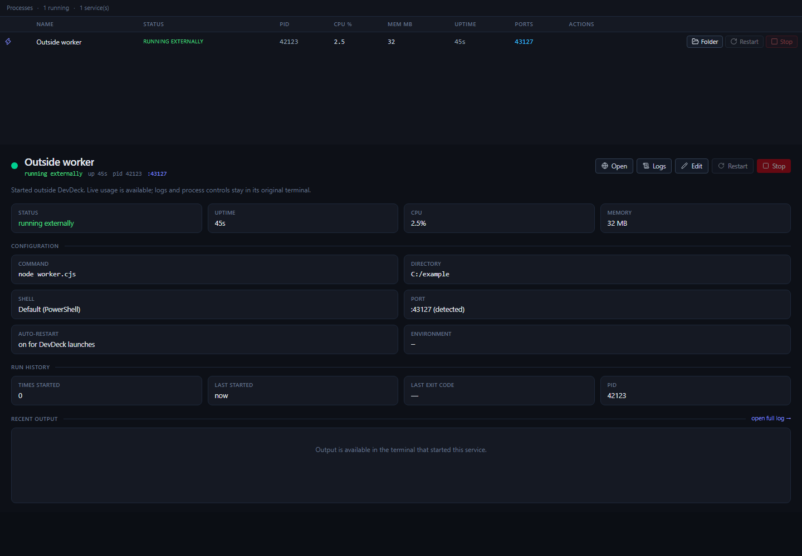
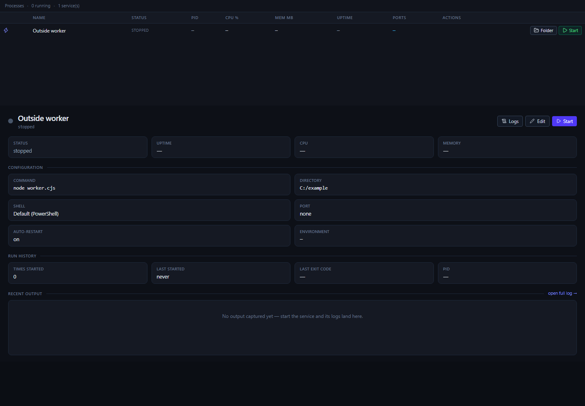

# External saved services

Verified on Windows on 31 October 2026, in branch `codex/external-services-1031`, based on `c679dc7` plus the working changes in this worktree.

Saved services now show processes started outside DevDeck. The monitor checks every two seconds, including while the windows are hidden. It uses the service's directory (including an inherited project directory) and its saved listening port, or its complete command when no port is saved. Matching launchers and children produce one service row. Conflicting definitions remain unassigned.

External runs expose status, PID, uptime, CPU, memory and listening ports. Their controls and logs remain with the original launcher. DevDeck does not auto-restart them or stop them on shutdown. When a process disappears, its saved service becomes stopped and Start is available again.

The service page and Home also convert service timestamps from seconds to milliseconds before formatting uptime. Shutdown now skips managed children that have already exited.

## Results

| Check | Result |
| --- | --- |
| `cargo check --manifest-path src-tauri/Cargo.toml --lib` | Passed; existing `imap-proto` future compatibility warning |
| `cargo test --manifest-path harness/external-services-native/Cargo.toml` | Seven tests passed |
| `harness/check-external-services-native.ps1` | Passed with a real Windows Node process and TCP listener |
| `node node_modules/typescript/bin/tsc -b` | Passed |
| `npm run lint` | Passed with existing warnings; store subscriptions and synchronous commands remain at baseline |
| `node harness/check-external-services.mjs` | Passed; no browser errors |
| Screenshot review | Passed after correcting the timestamp conversion |
| `git diff --check` | Passed |

The native probe imports the production matcher and reads a real process through sysinfo. PowerShell independently verifies that the fixture PID owns its TCP listener. It also checks an unrelated directory, a missing port, and disappearance after exit. The final live run matched PID 30544 on port 53462 and then verified its exit. The fixture was stopped and removed.

The browser fixture uses the production components, stores and service-status listener with a mocked IPC boundary. It verifies running status, PID, resource usage, ports, realistic uptime, disabled Stop/Restart controls, and an exit event restoring Start. These are separate native and frontend checks, not a packaged desktop end-to-end run.

## Evidence





## Reproduce

Build the probe, then run the live Windows check:

```powershell
cargo build --manifest-path harness/external-services-native/Cargo.toml
./harness/check-external-services-native.ps1
```

For the browser check, start Vite with `vite.harness.config.ts` on port 5217, then run `node harness/check-external-services.mjs`. Set `PLAYWRIGHT_MODULE` to a Playwright module entry file if Playwright is installed outside the project. The harness excludes Rust build output from file watching to avoid Windows file-lock errors.

## Limits

Windows must allow reading the process directory and command. The directory must match the saved or inherited service directory. With no saved port, command arguments must match; npm, pnpm and yarn CLI wrappers are recognized. Detection does not infer arbitrary shell scripts or attribute processes whose directories cannot be read. External exit codes and historical stdout/stderr are unavailable.

The change has not been merged, packaged or installed over the running desktop app.
