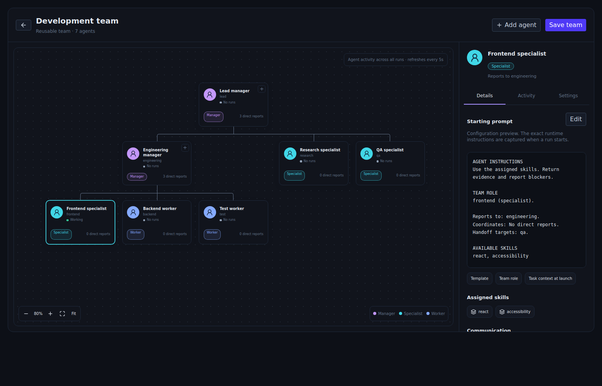

# Visual team builder

Screenshots use representative browser-harness data, not live customer activity.

Open **Workforce → Library** to browse **Agents** and **Skills** as cards or a table. Search, filter by source, sort, create definitions, or import from GitHub. Templates remain reusable; configure a member from a template inside a team.

**Workforce** opens on **Teams**. Search teams, filter working or solo teams, and switch between cards and a table. Choose **Create team**; a one-member team is supported. In **Settings**, name the team and give it a stable lowercase ID. Select an existing saved agent for the lead, or choose **Create member from library**. Configure a template or start from scratch; saving the member assigns it to the selected role automatically. Save the team to persist the assignment. Existing saved agent configurations remain available in the role selector; editing one also affects other teams that use it.

Use the **+** on a manager's card to add a direct report. Select **Manager**, **Specialist**, or **Worker** in Settings. Managers can have their own reports. Change **Reports to** to move a role; descendants cannot become their own managers. Choose handoff targets and add team-specific instructions. Save the team to persist it. Saving starts no work and grants no permissions.

Select any card to inspect its configured instructions, assigned skills, reporting manager, and handoff targets. **Activity** shows actual runs for that configured agent, including runs from other teams. It refreshes every five seconds. Select a run to inspect recorded activity and its saved launch instructions. Older runs have no retroactive prompt snapshot.

The canvas supports horizontal scrolling, zoom, and **Fit**. On narrower screens, the inspector sits below the diagram. Drafts remain while switching between Agents sections or opening the agent editor; use Save before leaving the Agents page or closing the app. Back to teams asks before discarding edits.

## Workflows and execution

Configured model and CLI agents share the personal Library agent database. Build uses the saved Team Builder definition, which appears in Library alongside configured team agents. Library edits update the same definition consumed by the corresponding execution adapter. Team assignments retain their existing identifiers; roles, reporting relationships, and role-specific instructions remain on the team. Model conversations and CLI workers retain their distinct execution capabilities.

Existing agent and worker files migrate without replacing newer Library edits. Legacy files remain as backups; deleted definitions are marked so those backups cannot restore them on restart. Imported agent templates remain source material for configuring an agent, with source and skill references preserved.

Choose the saved team in a folder workflow and map step roles as before. Saved role IDs stay fixed to avoid breaking workflow references. Team role instructions and reporting/handoff context are resolved into the workflow definition and included in worker launch instructions. Re-save an unstarted workflow to pick up changed team configuration; running workflows retain their existing context. The actual launch brief, including the selected template text, is copied into the run receipt at start.

The graph is a coordination structure, not a new autonomous delegation runtime. Dev and the existing workflow runner still start eligible workers and enforce dependency/review gates. Manager roles use configured workflow agents; separate legacy manager bots and AI workspace agents are not selectable in this builder. Reporting and handoff targets request coordination through Dev; drawing a link does not enable direct messaging or grant a tool.

Existing flat teams open as a draft hierarchy with their first role as lead. Their role names and worker assignments are preserved. Review that proposed structure before saving. Missing agents, invalid IDs, cycles, invalid handoffs, and stale team revisions are rejected.

## Verification

- TypeScript and production frontend bundle verified.
- Core Rust suite: 58 passing tests, including hierarchy validation and legacy/team-context compatibility.
- Browser harness exercises hierarchy edits, save/reopen, manager restrictions, prompt receipts, mobile layout and parent renaming.
- Browser fixtures substitute the Tauri IPC boundary. Actual Windows native launch/persistence and Android device behavior require device testing. The browser harness does not execute real worker processes.

## Vault managers in Library

Library includes the current vault's managers alongside personal model and CLI agents, with explicit Personal and Current vault filters. Manager definitions use the same agent schema in `<vault>/.devdeck/library/agents.sqlite`. Library edits and the manager runtime read the same record. Moving the vault preserves internal manager identities.

Legacy `.devdeck/team/*.md` files are retained as migration backups, not editable sources after migration. Coordination profiles remain in `.devdeck/team/roles/*.json`; these hold vault-specific responsibilities and peer/worker assignments. Feature ownership remains on the feature, and manager memory remains in the personal store. The Library manager editor changes name, goal, and instructions while preserving schedules, worker assignments, skills, and memory references. It rejects a stale edit or a change of active vault.

This connects manager definitions to Library. Vault coordination profiles remain vault-specific rather than being converted automatically into reusable Workforce teams.

## Build a team from a discussion

Open Workforce → Build and describe the work. Team Builder responds with short choices and a structured proposal. Review its organogram and responsibilities; choose existing Library agents for any roles you want to reuse. Create team saves all new agents and the team atomically, then opens the designer. Retrying the same request cannot duplicate agents or teams. New agents use the existing Claude Code/Sonnet defaults with no unattended grants; configure their model, skills, and tools before running work. Creating a team launches nothing.

Reusable teams now share the personal `library/agents.sqlite` database with their configured agents. Existing `library/teams.json` data migrates without replacing newer database records; the JSON remains a backup. Discussions, choices, proposals, and creation results survive reloads. New discussion starts a new conversation and proposal identity.

## Configuration snapshots

Model conversation participants retain their model and instruction snapshot for that conversation, including after reload. Start a new discussion to use updated settings. Manager coordination turns are individual runs, so each turn keeps current incoming messages and responsibilities. Runtime work sessions clone the agent at start and write a structured `.agent.json` snapshot beside the session receipt; CLI run receipts retain the worker definition plus the actual launch prompt. Live permission checks remain authoritative. CLI settings changed after a preview require another preview.

Resuming a saved conversation reuses its configuration snapshot. Restarting a terminated CLI/model work process is not an implemented resume feature; starting another work run takes a new snapshot. Existing historical runs without snapshots are not reconstructed retroactively.
