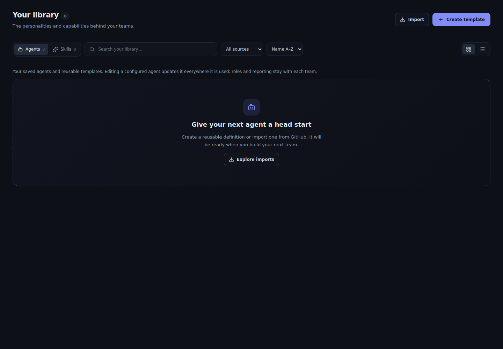
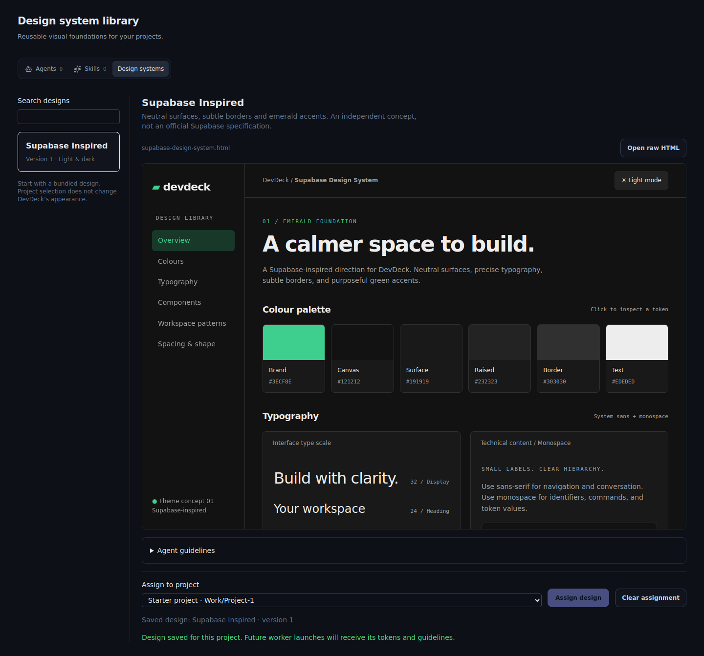
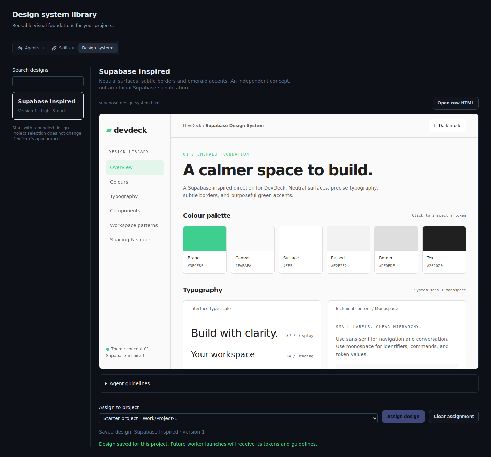
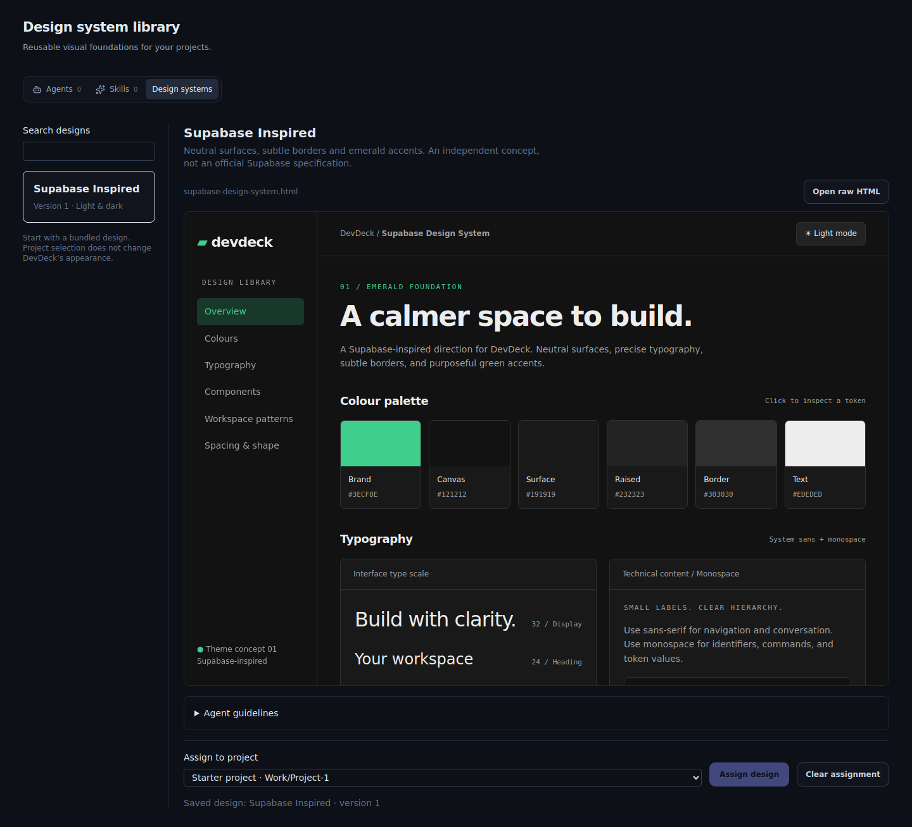
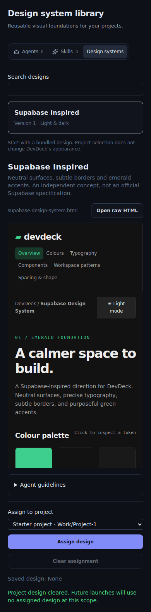

# Design System Library — verification report

Reviewed 2026-10-19. Base: `testing/desktop`, `196ab0590af76d93e22442225ca00923d5f78911`.

## User story

Open the library, preview a design, assign it to a project, reopen the selection, and pass its tokens and guidelines into future CLI worker/native workflow launches.

## HTML preview correction — 2026-10-19

The Library now renders the original HTML file directly in a script-enabled,
opaque-origin sandboxed iframe. Each catalog JSON is paired by basename with its
own HTML file. The HTML owns its themes and interactions. Open raw HTML toggles
an escaped source viewer containing the exact same file. Removed the duplicate
React specimens and their CSS. Assignment and agent guidance are unchanged.

TypeScript and the production bundle pass (existing bundle warnings remain).
All eight browser scenarios pass, including byte-for-byte source/iframe equality,
theme switching and the existing simulated assignment flows. Screenshots below
were refreshed for this correction. Native Windows verification remains unrun.

## Original implementation results

| Check | Result | Evidence / boundary |
| --- | --- | --- |
| TypeScript project build | PASS | `tsc -b` returned zero on the reviewed tree; `typecheck.txt` is empty because no diagnostics were emitted. |
| Portable Rust model | PASS, 6 tests | `rust-results.txt`; tests execute the production model, not a copied implementation. Covers persistence, prompt content/version, isolated projects, clear, stale revisions, corruption, unavailable version, failed-write preservation, and competing saves. |
| Browser scenarios | PASS, 8 scenarios | `browser-results.json`; real React panel/IPC wrappers with simulated Tauri storage using localStorage. Not a native desktop test. |
| Screenshot review | Refreshed captures inspected | Before, dark, light, mobile and reopen captures retained below. Captures show the original HTML embedded in the Library. |
| Browser rerun | PASS | Chromium completed all eight scenarios for the HTML preview correction. |
| Repository lint | FAIL on existing baseline | `lint.txt`: sync-command ratchet counts 70 against 68; reports `pty_scrollback` and `pty_list`. Reproduced from a clean archive of base commit 196ab05. These files and the ratchet are unchanged. Existing lint warnings also remain. |
| Whitespace | PASS | `git diff --check`. |
| Native Tauri integration / Windows | NOT RUN | Full native compile, IPC-to-vault persistence, hierarchy lookup and real provider launch still require the desktop environment. Integration points were reviewed in source, not proved end-to-end. |

## Before and after

Captures are from the browser harness and contain fixture projects, not live user data.

### Before


### Dark preview with saved assignment


### Light preview


### Reopened assignment


### Narrow viewport


## Reproduce

```sh
npx tsc -b
cargo test --locked --manifest-path harness/design-system-core/Cargo.toml
npm run lint
npx vite --config vite.harness.config.ts --host 127.0.0.1 --port 5199
# Separate terminal, with Playwright and its browser installed:
node harness/check-design-systems.mjs
node harness/capture-design-systems-before.mjs
```

The browser scripts also accept `PLAYWRIGHT_MODULE` and `PLAYWRIGHT_EXECUTABLE` for an existing local installation. The before-capture script reads the exact base commit and removes its temporary source files after capture.

## Windows acceptance

1. Build/start `testing/desktop` using the normal desktop setup.
2. Open Workforce → Library → Design systems. Check generic controls, colours, typography, and both preview modes.
3. Assign a design to a real project. Close and reopen DevDeck; verify the assignment persists in that project's vault `.devdeck/design-system.json`.
4. Check a second project remains independent. Clear the original selection and confirm it remains cleared after restart.
5. Launch a CLI worker and a native workflow for the assigned project; inspect generated briefs for the selected design ID/version, tokens and guidelines. Check a child feature inherits, and an explicit child clear stops inheritance.
6. Build a small new project with that guidance and compare its screens with the library. This final agent-driven build has not yet been performed.

## Scope and limitations

Project assignment is implemented. Reskinning DevDeck, adding editable/imported designs, and running the first new-project agent build remain separate milestones. Catalog data is bundled at compile time. The mutex serializes writes within this desktop process; cross-process vault editing is not a distributed locking system. The standalone HTML is rendered directly by the integrated preview; JSON remains the source consumed by agents.
